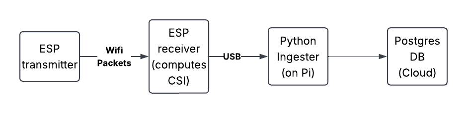
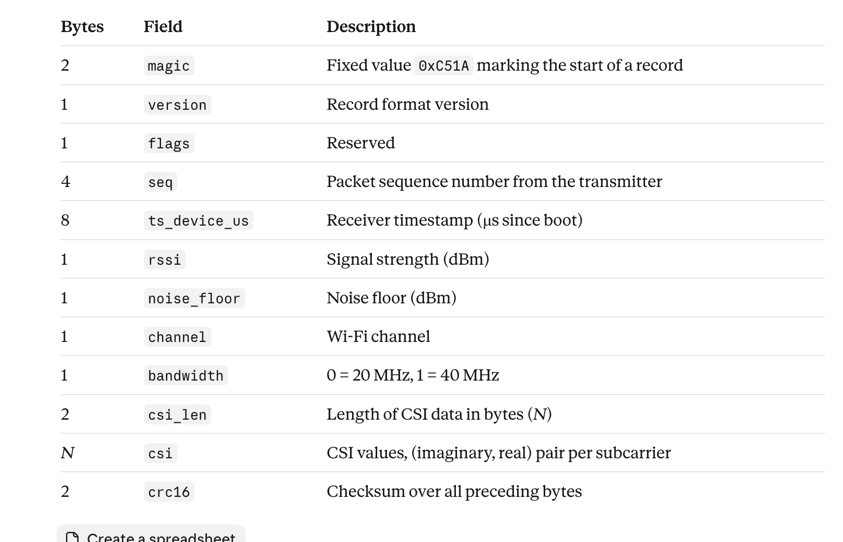

# Data Ingestion Layer

## Purpose

This document defines a basic process and schema for generating data from our hardware setup and storing it as raw CSI data and metadata, as well as some rough math on total data volume. The data I discuss in this doc doesn’t say anything about how many people are in the room or how they’re moving, etc, it’s just the raw data that be later used to infer those things.

## Overview

This diagram provides a basic overview of how I envision the data collection and storage flow working. This is a very high-level design, and I’ll get into the specifics of what the data looks like in the next section.

*Note: Kevin is working on a more comprehensive architecture plan. This diagram is subject to change, I just made it so that the data breakdown in the next section makes sense.*

## Data Breakdown

1. **ESP Transmitter to Receiver ESP**: The transmitter sends WiFi packets to the receiver, split across 64 frequencies. The receiver is then able to compute Channel State Information (CSI) for each frequency based on how the received data has been weakened or shifted compared to what was sent.

2. **ESP Receiver to Python Ingester**: The receiver sends a stream of binary data to the Raspberry Pi. There is a specific bit pattern that marks the beginning one CSI record. In a record, there are bytes representing the data we care about. To make this a little more clear I had Claude make a table of what a bit string might look like. Python can read this data stream like a file, so we will have a program that recieves the data and seperates it into individual records.

   

3. **Python to Cloud Postgres**: After separating the byte stream into individual CSI records, we upload those records to a cloud DB.

## Database Schema and Size

Each field of the binary data stream will map to a column in Postgres, so a row will be one CSI record. I haven’t fully worked out exactly what columns we’ll need yet.

If a CSI record is 24 bytes of metadata and 128 bytes of CSI, we have a total of 152 bytes per record. If we did 50 records per second, we would have ~8KB per second, and ~27MB per hour. We probably won’t even run sessions that long at first, and if we end up with too much data we can do less records per second.

Postgres adds some overhead data, so we could probably expect around 50MB of data ending up in the DB per hour of recording at 50 records/second. We could probably use the Supabase free tier for this, which provides a 500MB database, allowing storage of 10 hrs of data. If we get jammed we could look into storing the raw records in object storage instead.

## Notes

The result of this process is raw CSI data in a cloud database. There will be much more thought that will need to go into dealing with missed data, corrupted data, etc. But this is a good starting place for just getting the data in the first place.
